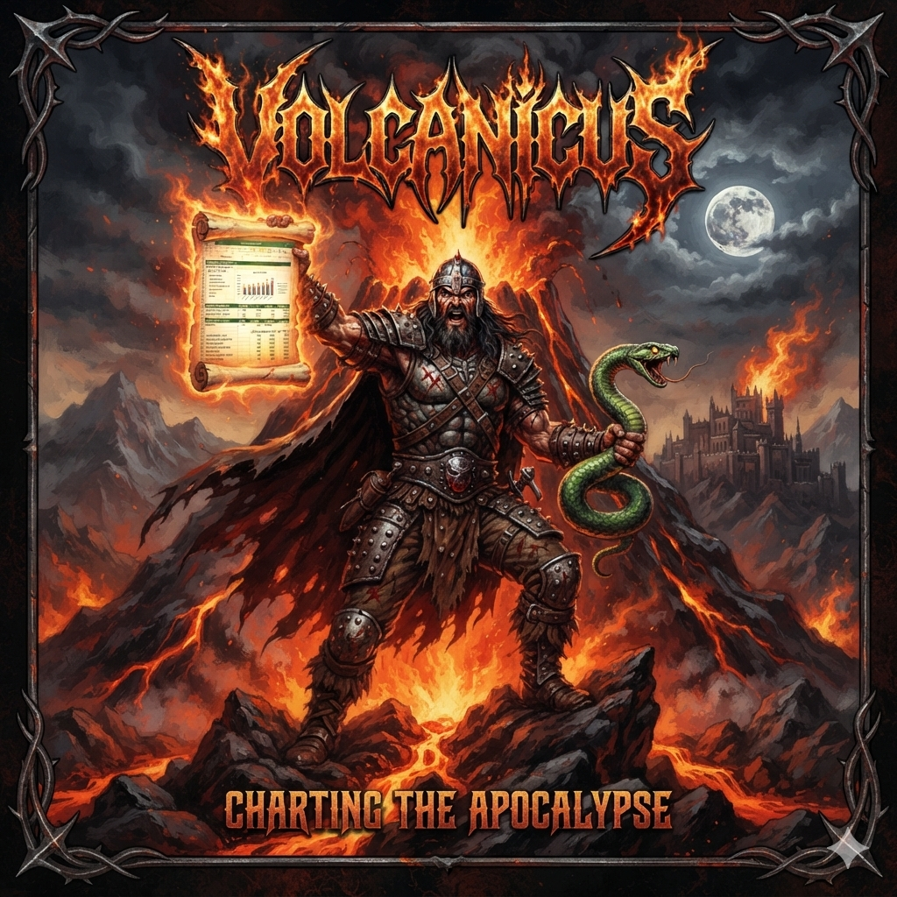

# Volcanicus



**A small toolkit to load, normalize and plot volcano deformation/residual measurements**

<!-- BODY -->

[](https://www.tldrlegal.com/l/bsd3)
[](https://www.python.org/)

**Volcanicus** wraps per-volcano residual/deformation measurements (one row
per date/direction, one column per distance bin) in a `Volcano` object, taking
care of dtype normalization and offering quick summary and plotting helpers
on top of the pandas stack.

## 📦 Installation

From the project root (this directory):

```bash
pip install -e .
```

### From GitHub:

```bash
pip install https://github.com/leliel12/volcanicus/archive/refs/heads/master.zip
```

### Development dependencies

```bash
pip install -r requirements_dev.txt
```


## 🚀 Usage

### Bundled datasets

Volcanicus bundles ~186 example volcanoes' worth of data, but
`datasets.fetch` currently only works for the ones with a per-pixel
parquet — right now, just `"erta_ale"`. The rest still only have the old,
pre-pivoted CSV, which `fetch` doesn't read yet. Each one still carries
its descriptive metadata (GVP identification, location, classification,
morphology and PyVOLCANS analogues):

```python
from volcanicus import datasets

datasets.available()  # ["erta_ale"], for now
erta = datasets.fetch("erta_ale")  # band="fused" by default

erta.gvp_lat, erta.gvp_lon  # (13.6033, 40.6633), GVP reference location
erta.metadata.country       # "Ethiopia"
erta.m.volcano_type_class   # "Shield volcano" (`.m` is a shorthand for `.metadata`)
```

`fetch` is named that way because, right now, it is entirely local — but a
future version may fetch some datasets remotely instead. Being backed by a
per-pixel parquet also means `erta_ale` can be pivoted into any of several
*bands* instead of a single fixed table:

```python
erta.band                                  # "fused"
erta.to_band("tir").band                   # "tir" — re-fetched, same volcano, different band
datasets.fetch("erta_ale", band="swir1")   # or ask for a band upfront
```

A volcano with no per-pixel source has `band is None` (not reachable via
`fetch` today, but true of one built directly with `Volcano(...)`, see
below).

### Working with a `Volcano`

```python
# normalized, read-only copy of the measurements
erta.to_dataframe()

# mean residual per distance bin, per direction
erta.radial_profile()

# residual vs. distance, one line per direction, with an aggregate median line
erta.plot.radial_profile()

# how the missing values are spread across directions (default) or
# dates: a DataFrame with `total`/`n_missing`/`proportion` columns and
# a trailing "TOTAL" row
erta.describe()
erta.describe(by="date")

# fill the gaps; the new instance keeps the original metadata (and band,
# if any) and records what was done
imputed = erta.impute()
imputed.m.imputed  # True
```

### Your own measurements

Build a `Volcano` directly from a `DataFrame` with a `date` column,
`center_lat`/`center_long`, a `direction` column and one column per distance
bin, plus the volcano's reference location from the Smithsonian's
[Global Volcanism Program](https://volcano.si.edu) (GVP):

```python
import pandas as pd
from volcanicus import Volcano

df = pd.read_csv("measurements.csv")
volcano = Volcano(
    "copahue",
    df,
    gvp_lat=-37.8561,
    gvp_lon=-71.1605,
    metadata={"country": "Argentina"},
)
```

## 🔭 Views of the data

The raw data is a long table: one row per **date × direction** and one
column per **distance** (8 directions, 30 bins from 15 to 885 m). Volcanicus
offers five *views* of it; each one changes the unit of analysis and answers
a different question. Every view is an accessor on the `Volcano`
(`v.scenes`, `v.descriptors`, `v.rays`, `v.anomalies`, `v.episodes`), and
calling it runs its main method: `v.rays()` is `v.rays.descriptors()`.

```
raw data ──► scenes ──► descriptors
    │           │
    └──► rays   └──► anomalies ──► episodes
```

| View | Unit | Answers | Main API |
|---|---|---|---|
| **Scene** | one date (8 directions × 30 distances) | What did the volcano look like that day? | `scenes()`, `scenes.reduce()`, `plot.scene()` |
| **Descriptors** | one scene condensed into 5 numbers | How hot, how far-reaching, and towards where? | `descriptors()`, `plot.polar()`, `plot.azimuth_rose()`, `plot.centers_map()` |
| **Ray** | one direction of one date | Is something happening in a single direction? | `rays()`, `rays.flag()`, `rays.mask()`, `plot.rays_rose()` |
| **Anomaly** | one scene against the volcano's usual state | Is this unusual *for this volcano*? | `anomalies.baseline()`, `anomalies()`, `plot.baseline()` |
| **Episode** | a run of consecutive anomalous scenes | When was there unusual activity, for how long, how intense? | `episodes.score()`, `episodes()`, `plot.episodes()` |

A typical flow:

```python
v = erta.to_band("tir").rays.mask()   # 1. mask corrupted rays
v.descriptors()                       # 2. what happened on each date
v.episodes().query("n_scenes >= 2")   # 3. when there were events
```

`rays.flag()`/`rays.mask()` (and the `1.0` saturation level they compare
against) were calibrated against the old, normalized-residual CSVs.
`"tir"`/`"swir1"`/`"swir2"` are on that same normalized scale, so they
behave the same way; `"lst"` (Kelvin) and `"fused"` (Watts, `erta`'s
default band) are not, so `flag()` flags nearly every ray there instead of
the handful of real artifacts it's meant to catch.

## 📓 Tutorials

> **Note:** written against `datasets.fetch`'s older, CSV-backed volcanoes
> (`etna`, `kadovar`, ...). With `fetch` currently limited to `erta_ale`
> (see [Bundled datasets](#bundled-datasets)), these won't run as-is until
> they're updated — the `Volcano` API and views themselves (`.scenes`,
> `.rays`, ...) are otherwise unaffected, by this or by which band a
> `Volcano` carries.

- [tutorials/00_quickstart.ipynb](tutorials/00_quickstart.ipynb) — full `Volcano` API
  walkthrough: loading datasets, plotting, the `.stats` accessor,
  missing-value reporting and imputation.
- [tutorials/01_comparison.ipynb](tutorials/01_comparison.ipynb) — compares
  several bundled volcanoes side by side (and overlaid).
- [tutorials/02_scenes.ipynb](tutorials/02_scenes.ipynb) — reshapes measurements
  into one scene per date (`scenes()`) and collapses directions
  (`scenes.reduce()`, `scenes.median()`, `scenes.max()`).
- [tutorials/03_scene_descriptors.ipynb](tutorials/03_scene_descriptors.ipynb) —
  condenses every scene into five descriptors (`descriptors()`),
  with caveats on corrupted values (the Kadovar case) and far-field weight.
- [tutorials/04_rays.ipynb](tutorials/04_rays.ipynb) — describes every direction
  of every scene (`rays()`), residual saturation, and flagging
  and masking corrupted rays (`rays.flag()`, `rays.mask()`).
- [tutorials/05_anomalies.ipynb](tutorials/05_anomalies.ipynb) — measures every
  scene against the volcano's usual state (`anomalies.baseline()`,
  `anomalies()`), making scenes comparable across volcanoes.
- [tutorials/06_episodes.ipynb](tutorials/06_episodes.ipynb) — finds periods of
  unusual activity as runs of anomalous scenes (`episodes.score()`,
  `episodes()`).

## 📜 License

Volcanicus is under
[The 3-Clause BSD License](LICENSE.txt)

This license allows unlimited redistribution for any purpose as long as
its copyright notices and the license's disclaimers of warranty are
maintained.

## 💬 Contact

**You can contact me at:** <hrosenfeld@gl.fcen.uba.ar>
