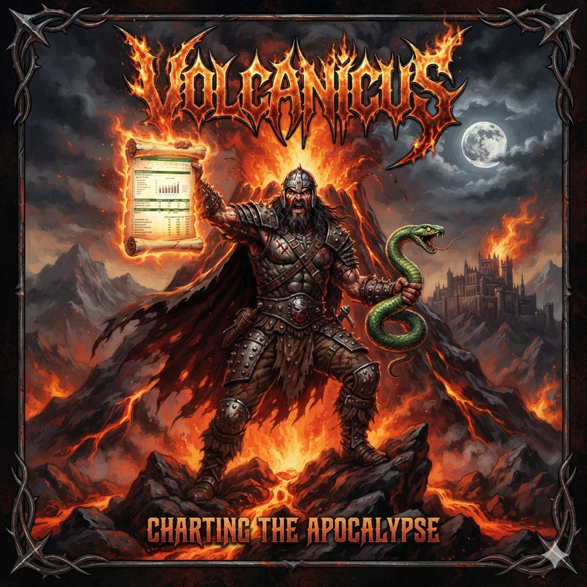

# Volcanicus



**A small toolkit to load, normalize and plot volcano deformation/residual measurements**

<!-- BODY -->

[](https://www.tldrlegal.com/l/bsd3)
[](https://www.python.org/)

**Volcanicus** wraps per-volcano residual/deformation measurements (one row
per date/direction, one column per distance bin) in a `Volcano` object, taking
care of dtype normalization and offering quick summary and plotting helpers
on top of the pandas stack.

## 📦 Installation

From the project root (this directory):

```bash
pip install -e .
```

### From GitHub:

```bash
pip install https://github.com/leliel12/volcanicus/archive/refs/heads/master.zip
```

### Development dependencies

```bash
pip install -r requirements_dev.txt
```


## 🚀 Usage

### Bundled datasets

Volcanicus ships 186 example datasets, loadable by name. Each one carries
the volcano's descriptive metadata (GVP identification, location,
classification, morphology and PyVOLCANS analogues):

```python
from volcanicus import datasets

datasets.available()  # ["agung", "aira", "akan", "alaid", ..., "zubair_group"]
etna = datasets.load("etna")

etna.gvp_lat, etna.gvp_lon  # (37.7442, 15.0107), GVP reference location
etna.metadata.country       # "Italy"
etna.m.volcano_type_class   # `.m` is a shorthand for `.metadata`
```

### Working with a `Volcano`

```python
# normalized, read-only copy of the measurements
etna.to_dataframe()

# mean residual per distance bin, per direction
etna.radial_profile()

# residual vs. distance, one line per direction, with an aggregate median line
etna.plot.radial_profile()

# how the missing values are spread across directions (default) or
# dates: a DataFrame with `total`/`n_missing`/`proportion` columns and
# a trailing "TOTAL" row
etna.describe()
etna.describe(by="date")

# fill the gaps; the new instance keeps the original metadata and
# records what was done
imputed = etna.impute()
imputed.m.imputed  # True
```

### Your own measurements

Build a `Volcano` directly from a `DataFrame` with a `date` column,
`center_lat`/`center_long`, a `direction` column and one column per distance
bin, plus the volcano's reference location from the Smithsonian's
[Global Volcanism Program](https://volcano.si.edu) (GVP):

```python
import pandas as pd
from volcanicus import Volcano

df = pd.read_csv("measurements.csv")
volcano = Volcano(
    "copahue",
    df,
    gvp_lat=-37.8561,
    gvp_lon=-71.1605,
    metadata={"country": "Argentina"},
)
```

## 🔭 Views of the data

The raw data is a long table: one row per **date × direction** and one
column per **distance** (8 directions, 30 bins from 15 to 885 m). Volcanicus
offers five *views* of it; each one changes the unit of analysis and answers
a different question.

```
raw data ──► scenes ──► descriptors
    │           │
    └──► rays   └──► anomalies ──► episodes
```

| View | Unit | Answers | Main API |
|---|---|---|---|
| **Scene** | one date (8 directions × 30 distances) | What did the volcano look like that day? | `to_scenes()`, `reduce_directions()`, `plot.scene()` |
| **Descriptors** | one scene condensed into 5 numbers | How hot, how far-reaching, and towards where? | `scenes_descriptors()`, `plot.polar()`, `plot.azimuth_rose()`, `plot.centers_map()` |
| **Ray** | one direction of one date | Is something happening in a single direction? | `rays_descriptors()`, `flag_rays()`, `mask_rays()`, `plot.rays_rose()` |
| **Anomaly** | one scene against the volcano's usual state | Is this unusual *for this volcano*? | `scenes_baseline()`, `scenes_anomaly()`, `plot.baseline()` |
| **Episode** | a run of consecutive anomalous scenes | When was there unusual activity, for how long, how intense? | `scenes_anomaly_score()`, `episodes()`, `plot.episodes()` |

A typical flow:

```python
v = datasets.load("kadovar").mask_rays()  # 1. mask corrupted rays
v.scenes_descriptors()                    # 2. what happened on each date
v.episodes().query("n_scenes >= 2")       # 3. when there were events
```

## 📓 Tutorials

- [notebooks/tutorial.ipynb](notebooks/tutorial.ipynb) — full `Volcano` API
  walkthrough: loading datasets, plotting, the `.stats` accessor,
  missing-value reporting and imputation.
- [notebooks/comparison.ipynb](notebooks/comparison.ipynb) — compares
  several bundled volcanoes side by side (and overlaid).
- [notebooks/scenes.ipynb](notebooks/scenes.ipynb) — reshapes measurements
  into one scene per date (`to_scenes()`) and collapses directions
  (`reduce_directions()`, `scenes_median`, `scenes_max`).
- [notebooks/scene_descriptors.ipynb](notebooks/scene_descriptors.ipynb) —
  condenses every scene into five descriptors (`scenes_descriptors()`),
  with caveats on corrupted values (the Kadovar case) and far-field weight.
- [notebooks/rays.ipynb](notebooks/rays.ipynb) — describes every direction
  of every scene (`rays_descriptors()`), residual saturation, and flagging
  and masking corrupted rays (`flag_rays()`, `mask_rays()`).
- [notebooks/anomalies.ipynb](notebooks/anomalies.ipynb) — measures every
  scene against the volcano's usual state (`scenes_baseline()`,
  `scenes_anomaly()`), making scenes comparable across volcanoes.
- [notebooks/episodes.ipynb](notebooks/episodes.ipynb) — finds periods of
  unusual activity as runs of anomalous scenes (`scenes_anomaly_score()`,
  `episodes()`).

## 📜 License

Volcanicus is under
[The 3-Clause BSD License](LICENSE.txt)

This license allows unlimited redistribution for any purpose as long as
its copyright notices and the license's disclaimers of warranty are
maintained.

## 💬 Contact

**You can contact me at:** <hrosenfeld@gl.fcen.uba.ar>
